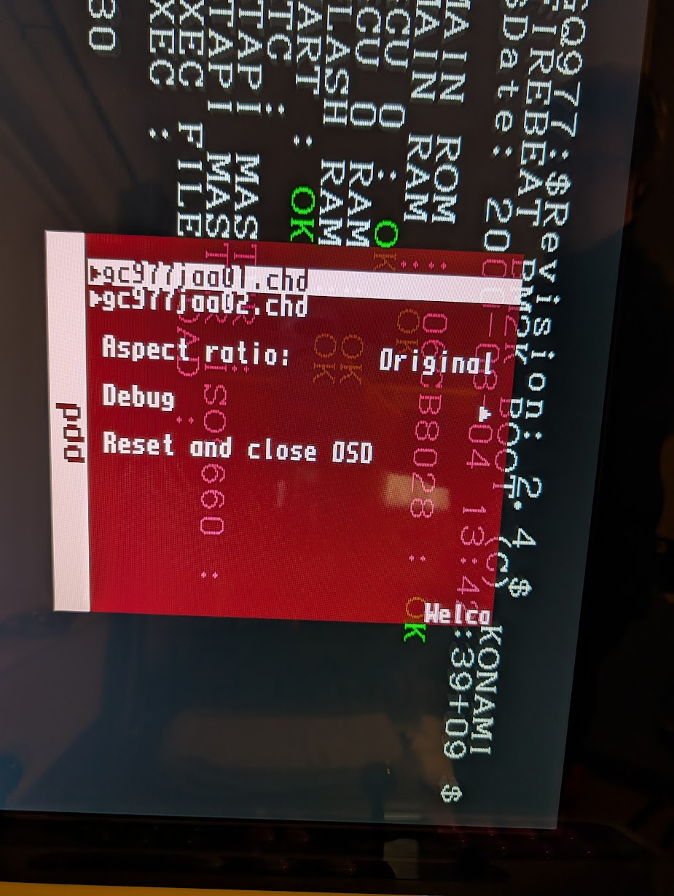
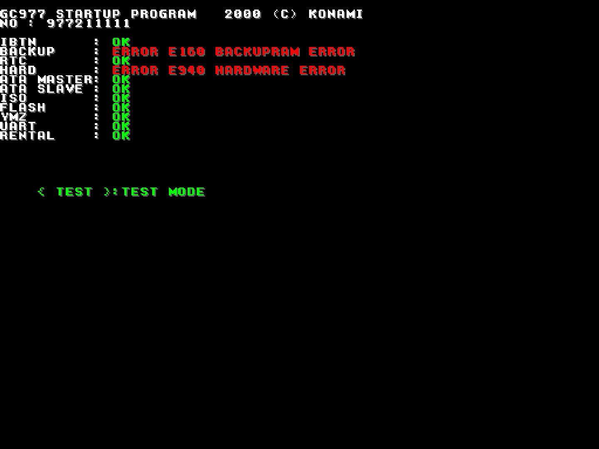
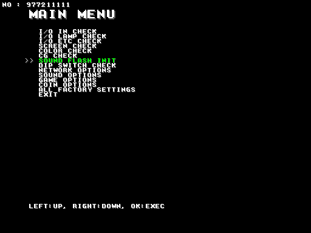
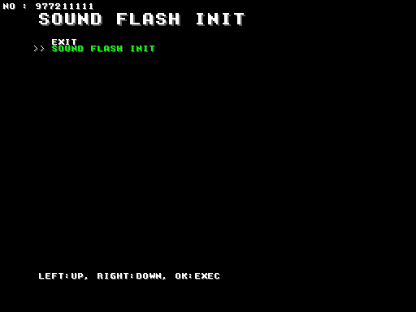
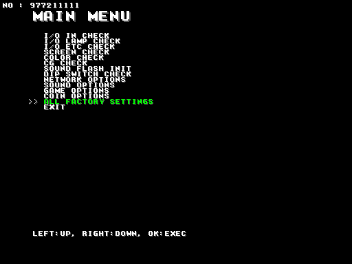
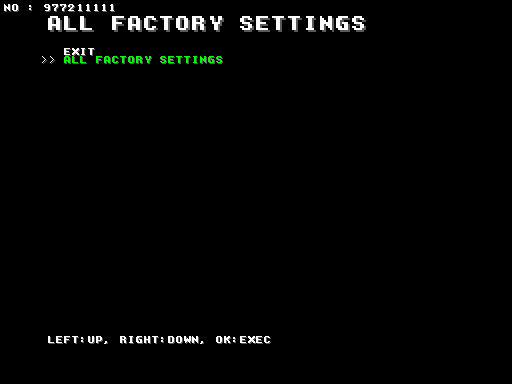
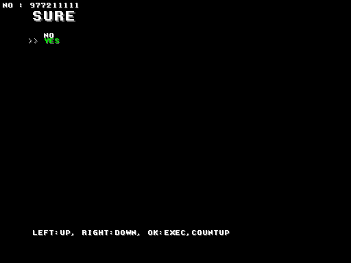

# Firebeat core for MiSTer

A MiSTer FPGA core for Konami's Firebeat arcade hardware (MAME's `konami/firebeat.cpp`), built
with Quartus Prime 17.0.2 Lite for the DE10-nano.

**Status: first release, `Arcade-Firebeat_20261101.rbf`. ParaParaParadise boots and plays on the board.**

## Contents

- [History](#history)
- [Games](#games)
  - [Installation](#installation)
  - [Supported](#supported)
  - [Not yet](#not-yet)
- [Hardware](#hardware)
  - [Video timing](#video-timing)
  - [Floorplan](#floorplan)
- [Screenshots](#screenshots)
- [Controls](#controls)
- [Status](#status)
  - [Todo](#todo)
  - [Resource usage](#resource-usage)
- [AI Attestation](#ai-attestation)
- [Verification](#verification)
- [Acknowledgements](#acknowledgements)
- [Layout](#layout)
- [License](#license)

## History

**20261101**
* First release - ParaParaParadise and clones only
* **READ the docs**


## Games
### Installation

A 128 MB SDRAM module is required.

#### 1. Core and .mra

* Take the latest `*.rbf` from `releases/` and put it in `_Arcade/cores`, renamed to drop the
  `Arcade-` prefix (`Arcade-Firebeat_YYYYMMDD.rbf` becomes `Firebeat_YYYYMMDD.rbf`). MiSTer launches
  the highest-sorting match for `<rbf>Firebeat</rbf>`, and a `Firebeat_*.rbf` sorts above every
  `Arcade-Firebeat_*.rbf`
* Take the `*.mra` files and the `_alternatives` folder from `releases/` and put them in `_Arcade`
  (or a subdirectory starting with an underscore, e.g. `_Arcade/_Firebeat`)
* Put the MAME ROM sets (`ppp.zip`, `ppp11.zip`, ...; merged or split) in `games/mame`

#### 2. Discs

Each set's two discs go in a folder named after the set, under `games/`, with MAME's file names:

| Game | Folder | Program CD | Audio CD |
|-|-|-|-|
| ParaParaParadise v1.1 | `games/ppp11/` | `gc977jaa01.chd` | `gc977jaa02.chd` |
| ParaParaParadise 1st Mix Plus | `games/ppp1mp/` | `a11jaa01.chd` | `a11jaa02.chd` |
| ParaParaParadise | `games/ppp/` | `977jaa01.chd` | `977jaa02.chd` |
| ParaParaDancing | `games/ppd/` | `977kaa01.chd` | `977kaa02.chd` |

Mount both from the OSD after loading the game: **Program CD** the `...01` disc, **Audio CD** the
`...02` disc.

e.g. for ParaParaParadise



MAME's CHDs need `MiSTer_Firebeat`, a Main_MiSTer build with the Firebeat CHD service (branch
`firebeat-chd`). Put it at `/media/fat/MiSTer_Firebeat` and add to `MiSTer.ini`:

```
[Firebeat*]
main=MiSTer_Firebeat
```

Raw `.bin` images (from `chdman extractcd`) should work with the standard Main.

#### 3. First boot: install from Test mode

On first boot it will stop at **E160 BACKUPRAM ERROR** and **E124 FLASH DATA ERROR**


Once, per game:


1. Press **Test** to enter Test mode.
2. **SOUND FLASH INIT** (seventh entry; Left/Right to move, Start to select)




3. **ALL FACTORY SETTINGS** (thirteenth entry), then YES.






4. Open the OSD so the NVRAM is saved ("Saving..." shows briefly; the OSD's Autosave option, on by
   default), then reset (OSD, "Reset and close OSD").

The game then boots to its warning screen and attract mode.


### Supported

Sets with an `.mra` in `releases/` (ppp1mp, a clone of ppp, in `_alternatives/_ParaParaParadise`).
ppp11 and ppp1mp have run on the board.

| Name | Year | Manufacturer | Discs | Notes |
|-|-|-|-|-|
| ParaParaParadise v1.1 (`ppp11`) | 2000 | Konami | `gc977jaa01`, `gc977jaa02` | the reference set |
| ParaParaParadise 1st Mix Plus (`ppp1mp`) | 2000 | Konami | `a11jaa01`, `a11jaa02` | dongle a bad dump in MAME |
| ParaParaParadise (`ppp`) | 2000 | Konami | `977jaa01`, `977jaa02` | program CD a bad dump in MAME |
| ParaParaDancing (`ppd`) | 2000 | Konami | `977kaa01`, `977kaa02` | program CD a bad dump in MAME; sensor bars 6-8 not mapped |

### Not yet

| Name | Why |
|-|-|
| Pop'n Music 4-8, Animelo, Mickey Tunes | the SPU board (68000, RF5C400, 32 MB wave RAM, DVD-ROM): Phase 8, in progress |
| beatmania III and its updates | SPU board plus a hard disk and floppy |
| Keyboardmania and its updates | two GCUs on two screens, an XT446 synth |

## Hardware

| Chip | Function | Status |
|-|-|-|
| PPC403GCX, 66 MHz | main CPU | Hornet core's `ppc403_core`, vendored; caches (I 16 KB, D 8 KB write-back) and DMA channel 3 written here; matches MAME over 2,000,000 instructions (`sim/cpu_tb`) |
| K057714 GCU | blitter, display lists, four display contexts, CRTC; 32 MB VRAM in DDR3 | written from MAME's model; VRAM and frames equal to MAME's on the captured windows (`sim/gcu_tb`, `sim/disp_tb`) |
| YMZ280B | 8-voice ADPCM/PCM from the sound flash | written from MAME's model; bench against a MAME capture |
| ATA, two CD-ROM drives | program CD and audio CD with CD audio | ATAPI written from MAME's model, over hps_io's image slots |
| 3 x 29F016A flash | program and samples, written by the game's install | written from MAME's model; SOUND FLASH INIT equal to MAME's (`sim/boot_tb`) |
| RTC65271 | clock and 4 KB NVRAM | written from MAME's model |
| PC16552D | network UART, unused by these sets | registers only (`docs/HACKS.md`) |
| DS1991 dongle | serial, mode, licence | written from `firebeat.cpp` |

### Video timing

These run at 24kHz - so don't expect an output on your 15kHz display...

512 x 384 visible of 685 x 416, pixel clock 16.667 MHz (`clk_sys` / 4): 24.33 kHz lines, 58.49 Hz
frames. The game switches the GCU to this mode (`firebeat.cpp` `control_w`); before that the
power-on mode is 640 x 480 of 800 x 525. MAME's `set_raw` declares 640 x 480 at 25.175 MHz,
59.94 Hz, which ParaParaParadise does not use. The board's 16.6666 MHz crystal is approximated by
`clk_sys` / 4, 4 ppm off (`docs/HACKS.md`).

### Floorplan

Where the logic sits on the Cyclone V, read from the compiled design with
`scripts/floorplan.py` (blocks defined in `scripts/floorplan.json`). One cell per LAB, M10K or DSP
site, coloured by the block owning most of it, brighter when fuller. The thin columns are M10K and
DSP; the empty area at the top right is the HPS; grey is the MiSTer framework. LUT counts are
combinational cells, two per ALM.

Not generated yet; it comes with the first release.

## Screenshots

### ParaParaParadise v1.1


### Development builds

`python scripts/build_staged.py`, then `python scripts/deploy.py` with a `mister.env` (see
`scripts/deploy.py`).

## Controls

| Input | Use |
|-|-|
| D-pad or stick left, right | menu select |
| Sensor 1-5 | the five sensor bars (hands over the bars) |
| Start | Start / OK |
| Coin, Test, Service | cabinet switches |
| Pause | suspends the CPU |

Keyboard, MAME's default keys: Left and Right on the arrows, sensors 1-5 on LCtrl LAlt Space
LShift Z, Start 1, Coin 5; F2 Test, P pause.

## Status

Known issues:

* **No 15 kHz output** (24 kHz analog only).
* ppd's sensor bars 6-8 are not mapped.

`docs/MAME_KLUDGES.md` lists what is taken from MAME as behaviour and what is known not to be
right. `docs/HACKS.md` lists this core's own approximations. `docs/ROADMAP.md` is the plan and its
progress; `docs/LESSONS_LEARNED.md` is what it cost.

### Todo

- [ ] Phase 6 standard features: DIPs, CRT Adjust, flip screen, audio mix
- [ ] Pop'n Music (Phase 8)
- [ ] Release: floorplan, Downloader database

### Resource usage

`Firebeat` revision at `a928331` (the 20261101 release), fitter seed 2, on the DE10-nano's Cyclone V
5CSEBA6, speed grade 7, every clock positive (`clk_sys` +0.499 ns, SDRAM +0.617 ns, HDMI +0.269 ns):

| resource | used | available |
| --- | --- | --- |
| Logic (ALMs) | 36,769 | 41,910 |
| Block memory bits | 1,170,720 | 5,662,720 |
| RAM blocks | 184 | 553 |
| DSP blocks | 66 | 112 |
| PLLs | 3 | 6 |

Logic is the one to watch: 88% of ALMs; the build before it missed timing at four seeds.

## AI Attestation

This core is being developed with heavy use of a frontier coding assistant.

## Verification

Not PCB-validated. MAME is the accuracy reference, with its own acknowledged uncertainties noted
where they matter.

* CPU and caches: 2,000,000 instructions of ppp11's play loop and 1,777,257 of its loading loop
  equal to MAME's (`sim/cpu_tb`).
* Board bus: 302,908 device accesses in MAME's order (`sim/board_tb`).
* Boot from power-on: 6,000 MAME frames, every ATA data word (7,098,647) equal to MAME's
  (`sim/boot_tb`).
* Flash install: 15,244,959 flash writes in MAME's order, the three chips equal at the end.
* GCU: VRAM 0 pixels differing on the attract and play windows (`sim/gcu_tb`); the shown frame
  equal to MAME's `screen_out` (`sim/disp_tb`).

## Acknowledgements

- **Sorgelig** and the **MiSTer-devel team** for the
  [Template_MiSTer](https://github.com/MiSTer-devel/Template_MiSTer) framework.
- The **MAMEdev team** — Ville Linde and the contributors to `firebeat.cpp`, `k057714.cpp` and the
  device files — for the emulation that is this core's specification.
- The Konami Hornet core's PPC403 (`rtl/cpu/ppc403/PROVENANCE.md`).

## Layout

Standard [Template_MiSTer](https://github.com/MiSTer-devel/Template_MiSTer) structure:

| path | contents |
| - | - |
| `sys` | MiSTer framework, vendored from the template, never edited |
| `rtl` | core source; vendored modules carry a `PROVENANCE.md` |
| `releases` | `.rbf` and `.mra` files; clones in `_alternatives`, work in progress in `_dev` |
| `docs` | roadmap, workflow, release process, kludges, hacks, lessons |
| `sim` | ModelSim and Verilator testbenches |
| `scripts` | build, deploy, capture and verification tooling |
| `debug` | reference captures from MAME used as ground truth (gitignored) |
| `roms` | your own MAME sets (gitignored, never committed) |

## License

GPL-3.0 (see `LICENSE`). Imported components keep their own licences; every modified vendored
file states the change in its header.

Game ROMs contain copyrighted material and are not included. Obtaining them is your
responsibility.
