# Konami Firebeat core for MiSTer

A MiSTer FPGA core for Konami's Firebeat arcade platforms (MAME's `konami/firebeat.cpp`), built
with Quartus Prime 17.0.2 Lite for the DE10-nano.

## Contents

- [History](#history)
- [Requirements](#requirements)
- [Games](#games)
  - [ParaParaParadise](#paraparaparadise)
  - [Pop'n Music](#popn-music)
  - [Keyboardmania](#keyboardmania)
  - [Not yet](#not-yet)
- [Hardware](#hardware)
  - [Video timing](#video-timing)
  - [Floorplan](#floorplan)
- [Screenshots](#screenshots)
- [Status](#status)
  - [Todo](#todo)
  - [Resource usage](#resource-usage)
- [AI Attestation](#ai-attestation)
- [Verification](#verification)
- [Acknowledgements](#acknowledgements)
- [Layout](#layout)
- [License](#license)

## History

**20261114**
* **Beta** Added: KeyboardMania/2nd/3rd `Arcade-Firebeat_kbm_*.rbf`
  * If you want Notes, you need some sort of MIDI device - currently supports the 'Arcade Sound Server' with a Soundfont player or a real MIDI keyboard, preferably with XG voices. MT32-Pi doesn't make sense really as you'd need to be in SoundFont mode with an XG font anyway.
  * English patch for the original KeyboardMania (the English graphics were lying in the filesystem, unreachable)
  * Known issues - Dual screen rendering doesn't quite keep up for now so limited to left OR right screen.
* Added SNAC support for the Pop 'N Music Playstation controller
* Added ROM patches to skip the RAM test at boot to save 25s of black screen (ParaParaParadise and Keyboardmania; not Pop'n Music, where they caused E121 SDRAM ERROR on some builds)
* NVRAM Autosave is now Off by default: save with the OSD's "Save settings"

**20261103**
* Added: Pop'n Music: `Arcade-Firebeat_popn_*.rbf`, popn4-8, Animelo, Animelo 2, Mickey Tunes and clones
* `Firebeat_disc_slots.zip`: every set's discs already mounted
* ParaParaParadise's core renamed `Arcade-Firebeat_ppp_*.rbf` 
  `Firebeat_2026*.rbf` can be deleted
* **READ the docs for Pop'n Music as it's different**

**20261101**
* First release - ParaParaParadise and clones only
* **READ the docs**

## Requirements

* A 128 MB SDRAM module is required (technically 64MB is enough for PPP, but Pop'n Music and Keyboardmania needs 128MB)

* Raw `.bin` images (from `chdman extractcd`) should work with the standard Main.
CHDs need `MiSTer_Firebeat`, a Main_MiSTer build with CHD support for Firebeat. Upload it as `MiSTer_Firebeat` in the root of the SDCard and add to `MiSTer.ini`:

```
[Firebeat*]
main=MiSTer_Firebeat
```

* Installing `releases/Firebeat_disc_slots.zip` will prevent you having to manually mount all of the CHDs/discs during boot. It should be unzipped in the root of the SDCard.

## Games
#### Cores and .mra's

* Take the latest `Arcade-Firebeat_*.rbf`s from `releases/` and put them in `_Arcade/cores`,
  renamed to drop the `Arcade-` prefix (e.g. `Arcade-Firebeat_ppp_YYYYMMDD.rbf` becomes
  `Firebeat_ppp_YYYYMMDD.rbf`). MiSTer launches the highest-sorting match for
  `<rbf>Firebeat_ppp</rbf>`, and a `Firebeat_ppp_*.rbf` sorts above every `Arcade-Firebeat_ppp_*.rbf`
* Take the `*.mra` files and the `_alternatives` folder from `releases/` and put them in `_Arcade`
  (or a subdirectory starting with an underscore, e.g. `_Arcade/_Firebeat`)

### ParaParaParadise

#### 1. ROMs

The MAME sets (`ppp.zip`, `ppp11.zip`, ...; merged or split) in `games/mame`.

#### 2. Discs

Each set's two discs go in a folder named after the set, under `games/`, with MAME's file names:

| Game | Folder | Program CD | Audio CD |
|-|-|-|-|
| ParaParaParadise v1.1 | `games/ppp11/` | `gc977jaa01.chd` | `gc977jaa02.chd` |
| ParaParaParadise 1st Mix Plus | `games/ppp1mp/` | `a11jaa01.chd` | `a11jaa02.chd` |
| ParaParaParadise | `games/ppp/` | `977jaa01.chd` | `977jaa02.chd` |
| ParaParaDancing | `games/ppd/` | `977kaa01.chd` | `977kaa02.chd` |

Mount both from the OSD after loading the game: **Program CD** the `...01` disc, **Audio CD** the
`...02` disc. If you followed the earlier step this should be avoided.

**ATAPI: NG, ERROR 140: ATAPI INIT ERROR** at the BIOS's check means no Program CD was mounted: mount it, then reset (OSD, "Reset and close OSD").

e.g. for ParaParaParadise

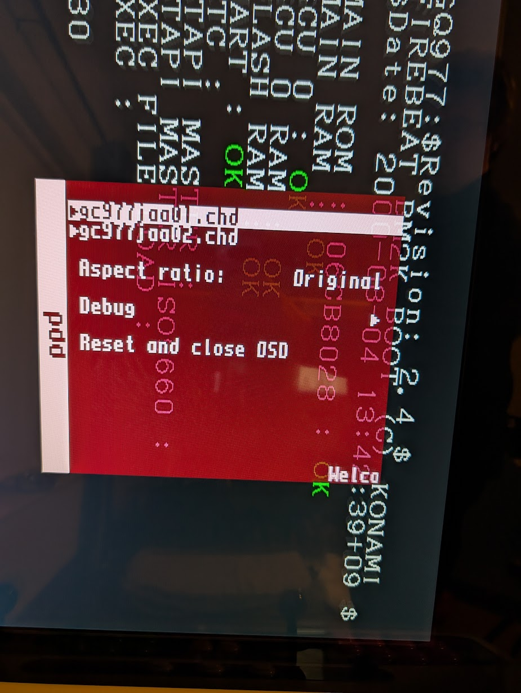

#### 3. First boot: install from Test mode


On first boot it will stop at **E160 BACKUPRAM ERROR** and **E124 FLASH DATA ERROR**
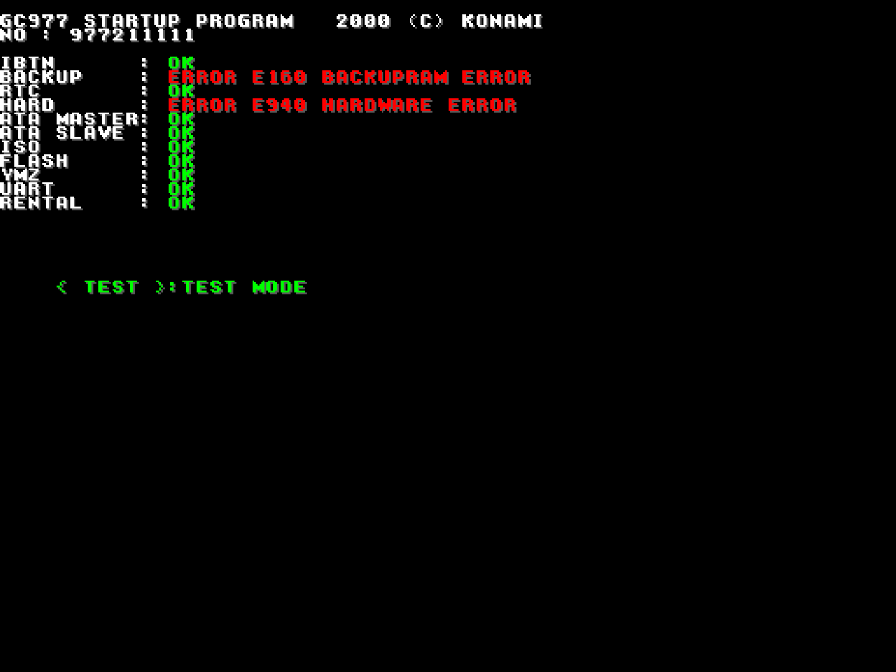

Once, per game:

1. Press **Test** to enter Test mode.
2. **SOUND FLASH INIT** (seventh entry; Left/Right to move, Start to select)

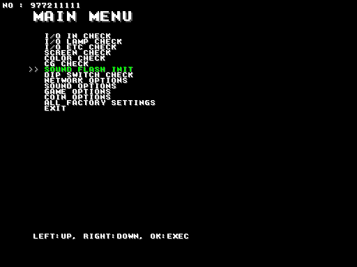
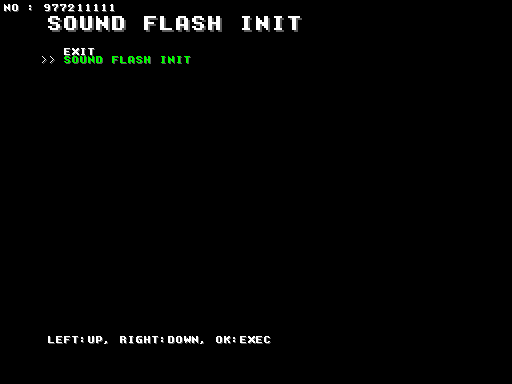

3. **ALL FACTORY SETTINGS** (thirteenth entry), then YES.

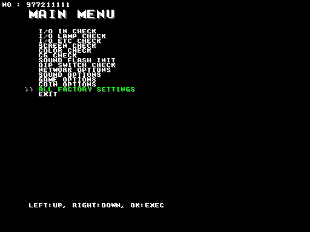
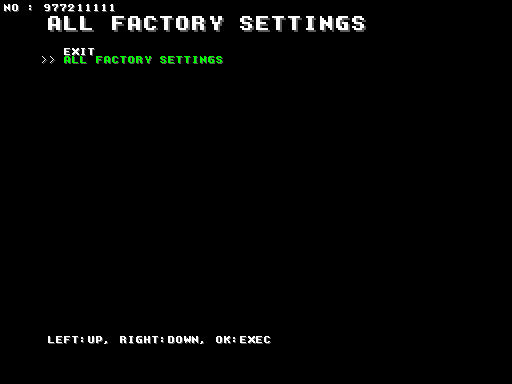
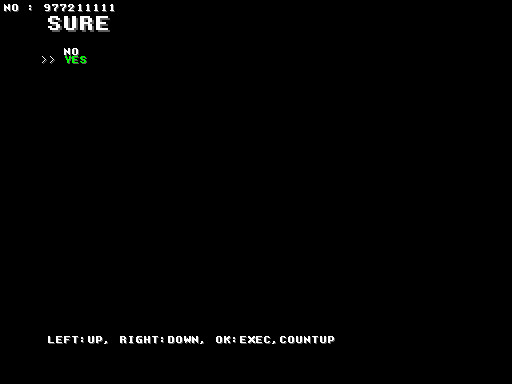


4. Save the NVRAM: OSD, "Save settings" (with the OSD's Autosave option On, opening the OSD saves it
   instead; Autosave is Off by default so that a bad run cannot save over a good file), then reset
   (OSD, "Reset and close OSD").

The game then boots to its warning screen and attract mode.

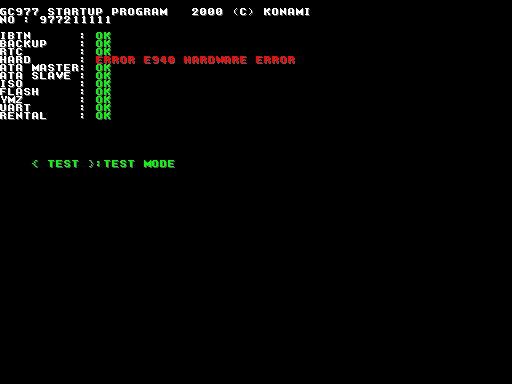

#### 4. Controls

| Input | Use |
|-|-|
| D-pad or stick left, right | menu select |
| Sensor 1-5 | the five motion sensors |
| Start | Start / OK |
| Coin, Test, Service | cabinet switches |
| Pause | suspends the CPU |

Keyboard, MAME's default keys: Left and Right on the arrows, sensors 1-5 on LCtrl LAlt Space
LShift Z, Start 1, Coin 5; F2 Test, P pause. 

Controllers:

| Controller | Game | Connection | Set-up |
|-|-|-|-|
| ParaParaParadise controller (PS2) | ParaParaParadise | USB | ***NOT WORKING YET***. Needs `MiSTer_Firebeat` (above), which switches it on; map its sensors to Sensor 1-5. This is based on sending the magic bytes indicated here https://github.com/Tatsh/pppps2pc/blob/master/pppps2pc/constants.py#L25 |

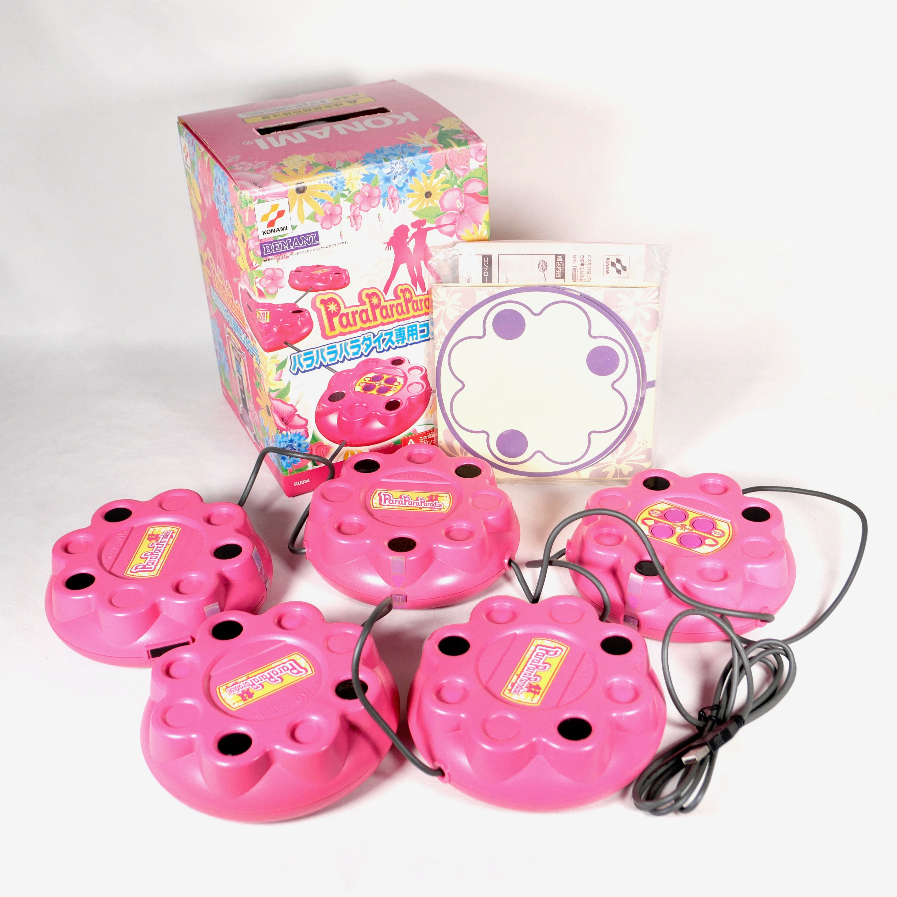

### Pop'n Music

#### 1. ROMs

The MAME sets (`popn4.zip`, `popn8.zip`, ...; merged or split) in `games/mame`. Each set's `.mra`
also loads its RTC preset from the zip (MAME's "default unlocked RTC").

#### 2. Discs

Each set's two discs go in a folder named after the set, under `games/`, with MAME's file names:

| Game | Folder | Program CD | Data DVD |
|-|-|-|-|
| Pop'n Music 4 | `games/popn4/` | `gq986jaa01.chd` | `gq986jaa02.chd` |
| Pop'n Music 5 | `games/popn5/` | `a04jaa01.chd` | `a04jaa02.chd` |
| Pop'n Music 6 | `games/popn6/` | `gqa16jaa01.chd` | `gqa16jaa02.chd` |
| Pop'n Music 7 | `games/popn7/` | `b00jab01.chd` | `b00jaa02.chd` |
| Pop'n Music 8 | `games/popn8/` | `gqb30jaa01.chd` | `gqb30jaa02.chd` |
| Pop'n Music Animelo | `games/popnanm/` | `gq987jaa01.chd` | `gq987jaa02.chd` |
| Pop'n Music Animelo 2 (JAC) | `games/popnanm2/` | `a02jac01.chd` | `gea02jaa02.chd` |
| Pop'n Music Animelo 2 (JAA) | `games/popnanm2ja/` | `a02jaa01.chd` | `gea02jaa02.chd` |
| Pop'n Music Mickey Tunes | `games/popnmt/` | `976jaa01.chd` | `976jaa02.chd` |
| Pop'n Music Mickey Tunes! | `games/popnmt2/` | `976jba01.chd` | `976jaa02.chd` |

The license-expired clones use the folder of the set with the same discs: `popnanma` popnanm's,
`popnanm2a` popnanm2's, `popnanm2jaa` popnanm2ja's.

Mount both from the OSD after loading the game: **Program CD** the `...01` disc, **Data DVD** the `...02` disc. If you followed the earlier step this should be avoided.

**ATAPI: NG, ERROR 140: ATAPI INIT ERROR** at the BIOS's check means no Program CD was
mounted: mount it, then reset (OSD, "Reset and close OSD").

#### 3. First boot

No install step: with the RTC preset loaded the game passes its boot check (SECURITY to FLUSH), loads the music data from the DVD and goes to attract mode.

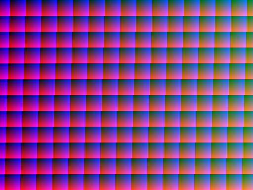
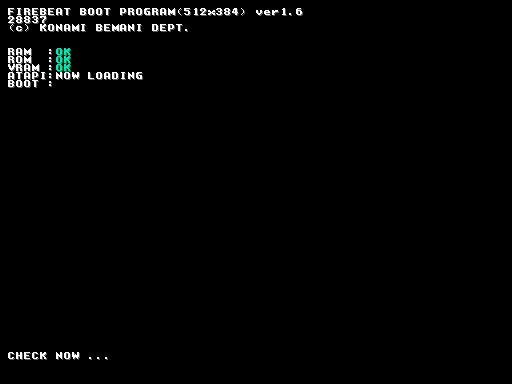
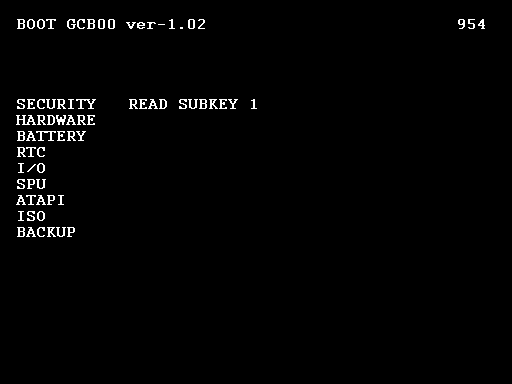
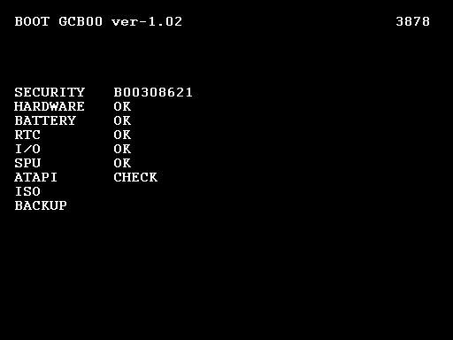
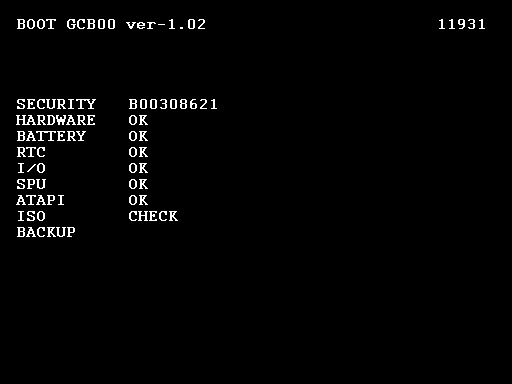
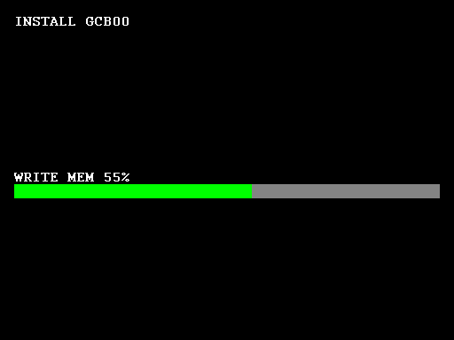
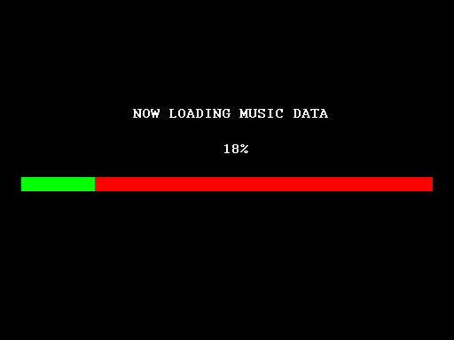

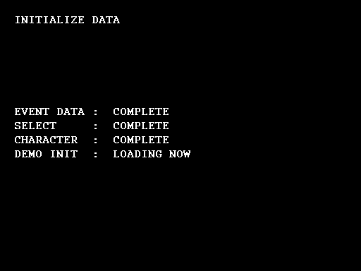

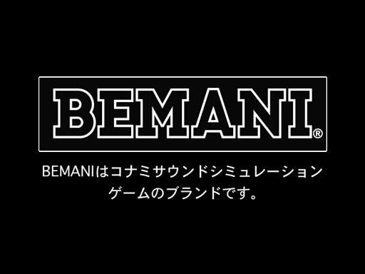

**RTC errors** (E165 RTC DATA ERROR, then a "system recovery mode" asking for a password): the
saved NVRAM's RTC is bad, and the NVRAM file loads after the preset and replaces it. If you hit issues, you can try deleting `/media/fat/config/nvram/<game>.nvm`, to clear the game's settings. A recovery password can be computed from the RTC's contents with
https://987123879113.github.io/firebeatrtc/ but shouldn't be needed.

#### 4. Controls

| Input | Use |
|-|-|
| Button 1-9 | the nine buttons, left to right: White 1, Yellow 1, Green 1, Blue 1, Red, Blue 2, Green 2, Yellow 2, White 2 |
| Coin, Test, Service | cabinet switches |
| Pause | suspends the CPU |

Keyboard, MAME's default keys: buttons 1-9 on LCtrl LAlt Space LShift Z X C V B, Coin 5; F2 Test,
P pause. Controllers: [Peripherals](#peripherals).

| Controller | Game | Connection | Set-up |
|-|-|-|-|
| Pop'n Music controller (PlayStation) | Pop'n Music | USB adapter | map like any pad |
| Pop'n Music controller (PlayStation) | Pop'n Music | user port, SNAC adapter (PSX core wiring) | OSD **Pop'n controller** to SNAC (Firebeat_popn only). Select is Coin. |

Playstation 1 controller buttons mappings:
| Button | 1 | 2 | 3 | 4 | 5 | 6 | 7 | 8 | 9 |
|-|-|-|-|-|-|-|-|-|-|
| Colour | White | Yellow | Green | Blue | Red | Blue | Green | Yellow | White |
| Pad button | Triangle | Circle | R1 | Cross | L1 | Square | R2 | Up | L2 |

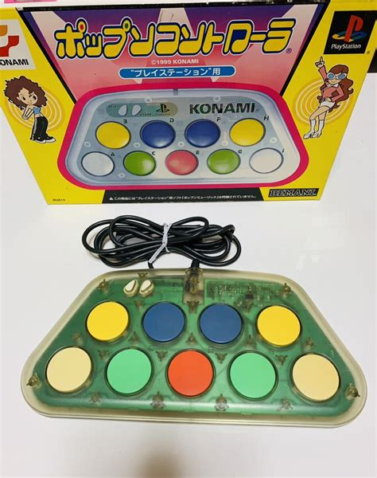


### Keyboardmania

#### 1. ROMs

The MAME sets (`kbm.zip`, `kbm2nd.zip`, `kbm3rd.zip`; `kbh` is a clone in `kbm.zip`) in
`games/mame`. Each `.mra` also carries an RTC preset (`scripts/rtc/`).

#### 2. Discs

Each set's two discs go in a folder named after the set, under `games/`, with MAME's file names
(they contain spaces):

| Game | Folder | Program CD | Audio CD |
|-|-|-|-|
| Keyboardmania | `games/kbm/` | `gq974-ja c01.chd` | `gq974-ja a02.chd` |
| Keyboardheaven (Korea) | `games/kbh/` | `gu974-ka a01.chd` | `gu974-ka a02.chd` |
| Keyboardmania 2nd Mix | `games/kbm2nd/` | `a01 ja a01.chd` | `a01 ja a02.chd` |
| Keyboardmania 3rd Mix | `games/kbm3rd/` | `a12jaa01.chd` | `a12jaa02.chd` |

Mount both from the OSD after loading the game: **Program CD** the `...01` disc, **Audio CD** the
`...02` disc. `Firebeat_disc_slots.zip` does not cover these sets yet.

**ATAPI: NG, ERROR 140: ATAPI INIT ERROR** at the BIOS's check means no Program CD was
mounted: mount it, then reset (OSD, "Reset and close OSD").

#### 3. First boot

Each set's `.mra` carries an RTC preset, so the game boots past the battery check (**E161**).
On their first boot 2nd and 3rd Mix run ALL FACTORY SETTINGS and initialise the sound flash from
the CD by themselves. Keyboardheaven stops at **E761 PCM DATA ERROR**: run **SOUND FLASH INIT** from
Test mode once. Then save the NVRAM (OSD, "Save settings"), or the next boot does it all again.
If a set still shows E161, an older saved NVRAM is overriding the preset: delete
`/media/fat/config/nvram/<game>.nvm`.

If the soundeffects are white noise, the saved NVRAM may not have flashed correctly from the roms: run **SOUND FLASH INIT** from
Test mode, or delete `/media/fat/config/nvram/<game>.nvm`. 

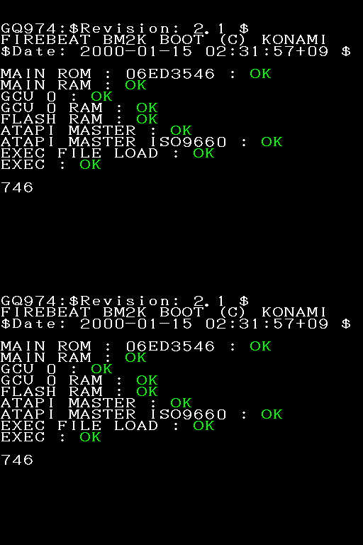
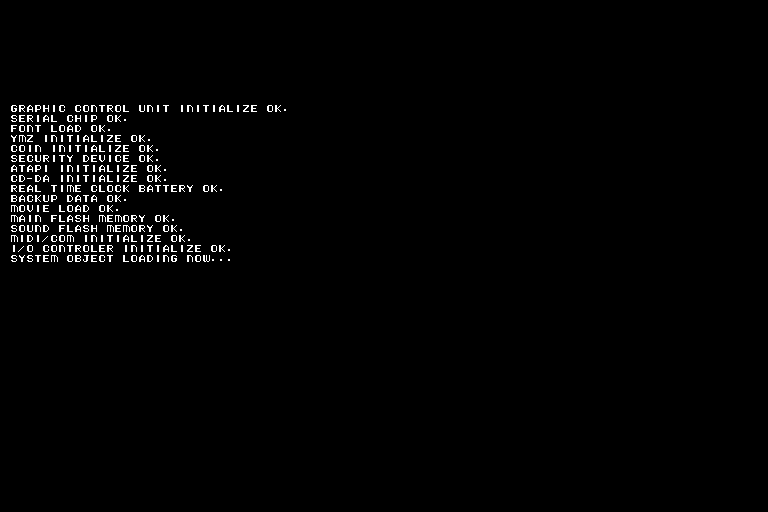
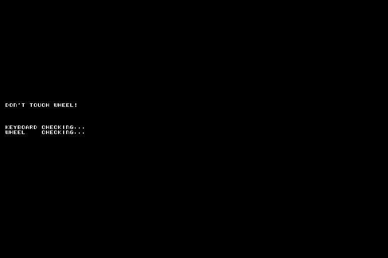

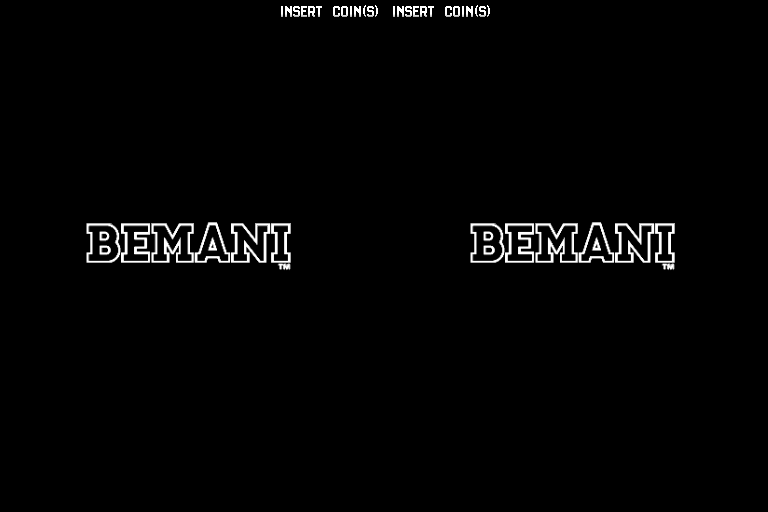
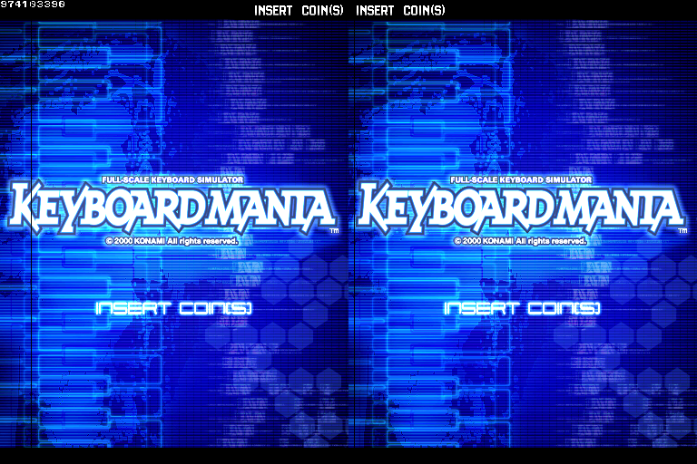

#### 4. Controls

Two players, each with their own keyboard, wheel and cabinet switches.

| Input | Use |
|-|-|
| Up, Down | the jog wheel |
| Start | Start / OK |
| Coin, Test, Service | cabinet switches |
| Pause | suspends the CPU |

Keyboard, MAME's keys: the 24 keys on Q W E R T Y U I O A S D F G H J K L Z X C V B N (C1 to
B2), on both players' keyboards; Start 1 and 2, Coin 5 and 6, F2 Test, P pause, the arrows
player 1's wheel. A second USB keyboard can be player 2: [Peripherals](#peripherals).

A MIDI keyboard (USB, or 5-pin through a USB MIDI cable) can be used to play the keys as well as playback the notes and is obviously the preferred option.
Select:
* **OSD UART mode**
* **MIDI**
* **MidiLink USB**

OSD options:
* **MIDI note offset** picks the 24 notes used (60, middle C, by default: on a 61-key
keyboard, the 24 keys from the third C); 
* **MIDI keyboard** - 'Split' gives player 2 the next two octaves. 
* The game's music and key sounds go back out to the same port, so a keyboard with XG voices plays correctly. 
* **Notes to** picks where they play: the
MIDI port (the Arcade Sound Server stays silent), both, or the Arcade Sound Server only.
* Also note, that the core sends 'Local Control Off (CC 122)' on channel 1 as the output starts and every 2s, so the keyboard plays souinds for only what the game sends; a keyboard that ignores CC 122 needs its Local Control set off by hand, or the keys sound twice. 

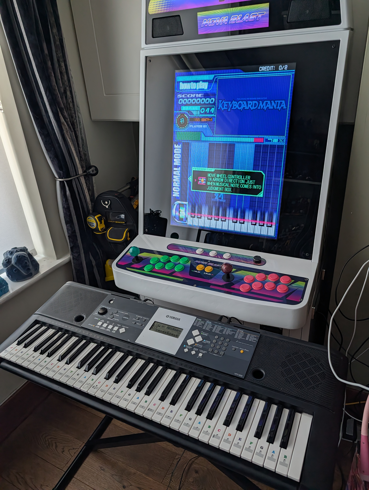

Alternatively to using a real keyboard, you need another MIDI device to playback the notes.
this have been added to the 'Hybrid Arcade Sound Server'.
You can choose the soundfont in the games/arcsnd/arcsnd.ini config file.

Mapping multiple USB keyboards:
Added recently for Psikyo-PS4, it's possible to use multiple USB keyboards independently, but you have to tell it to use the keyboard as a controller _instead_. It won't be mapped to control the OSD by default in that case. You need to use 'keyboard_as_joystick' for that, withthe VID/PID for your USB device, and optionally, you can force it to be bound to a particular player as here.
```
[Firebeat*]
main=MiSTer_Firebeat
keyboard_as_joystick=0x3434D030
;player_1_controller=046D_4024 
player_2_controller=3434_D030
```


### Not yet

| Name | Why |
|-|-|
| beatmania III and its updates | SPU board plus a hard disk and floppy |

## Hardware

| Chip | Function | Status |
|-|-|-|
| PPC403GCX, 66 MHz | main CPU | Hornet core's `ppc403_core`, vendored; caches (I 16 KB, D 8 KB write-back) and DMA channel 3 written here; matches MAME over 2,000,000 instructions (`sim/cpu_tb`) |
| K057714 GCU | blitter, display lists, four display contexts, CRTC; 32 MB VRAM in DDR3 | written from MAME's model; VRAM and frames equal to MAME's on the captured windows (`sim/gcu_tb`, `sim/disp_tb`) |
| YMZ280B | 8-voice ADPCM/PCM from the sound flash | written from MAME's model; bench against a MAME capture |
| ATA, two CD-ROM drives | program CD and audio CD with CD audio | ATAPI written from MAME's model, over hps_io's image slots |
| 3 x 29F016A flash | program and samples, written by the game's install | written from MAME's model; SOUND FLASH INIT equal to MAME's (`sim/boot_tb`) |
| RTC65271 | clock and 4 KB NVRAM | written from MAME's model |
| PC16552D | network UART, unused by these sets | registers only (`docs/HACKS.md`) |
| DS1991 dongle | serial, mode, licence | written from `firebeat.cpp` |

### Video timing

These run at 24kHz - so don't expect an output on your 15kHz display...

512 x 384 visible of 685 x 416, pixel clock 16.667 MHz (`clk_sys` / 4): 24.33 kHz lines, 58.49 Hz
frames. The game switches the GCU to this mode (`firebeat.cpp` `control_w`); before that the
power-on mode is 640 x 480 of 800 x 525. MAME's `set_raw` declares 640 x 480 at 25.175 MHz,
59.94 Hz, which ParaParaParadise does not use. The board's 16.6666 MHz crystal is approximated by
`clk_sys` / 4, 4 ppm off (`docs/HACKS.md`).

### Floorplan

Where the logic sits on the Cyclone V, read from the compiled design with
`scripts/floorplan.py` (blocks defined in `scripts/floorplan.json`). One cell per LAB, M10K or DSP
site, coloured by the block owning most of it, brighter when fuller. The thin columns are M10K and
DSP; the empty area at the top right is the HPS; grey is the MiSTer framework. LUT counts are
combinational cells, two per ALM.

The 20261114 release builds (fitted on that date); block counts and extents per group are in each
`_groups.md`.

`Firebeat` (released as `Firebeat_ppp`), `4fe2684`, seed 10 ([groups](docs/floorplan/Firebeat_groups.md)):

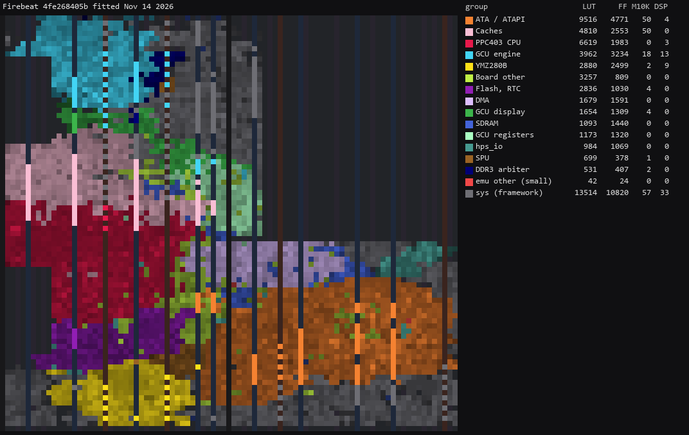

`Firebeat_popn`, `d230ee8`, seed 4 ([groups](docs/floorplan/Firebeat_popn_groups.md)):

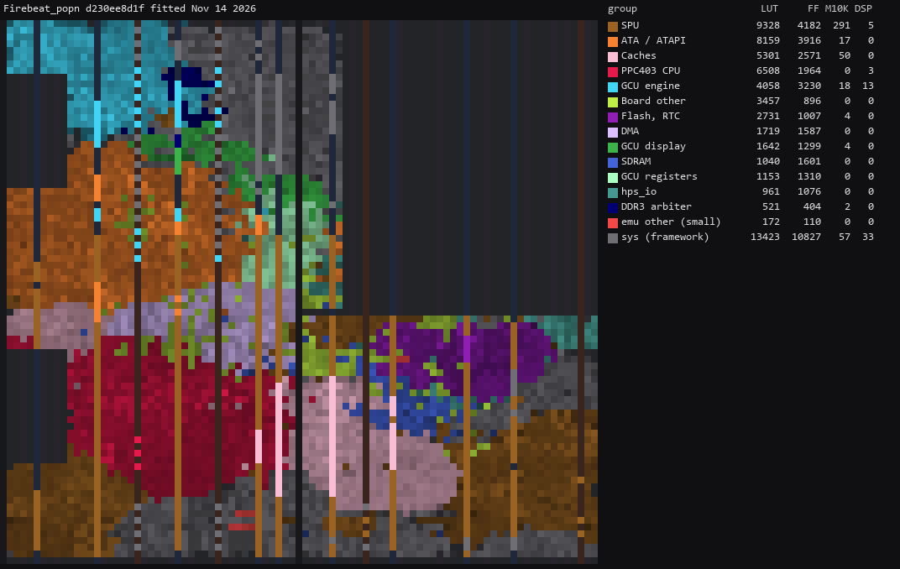

`Firebeat_kbm`, `3a51f90`, seed 12 ([groups](docs/floorplan/Firebeat_kbm_groups.md)):

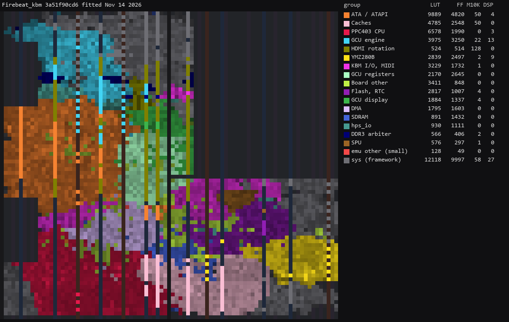

## Screenshots

### ParaParaParadise v1.1

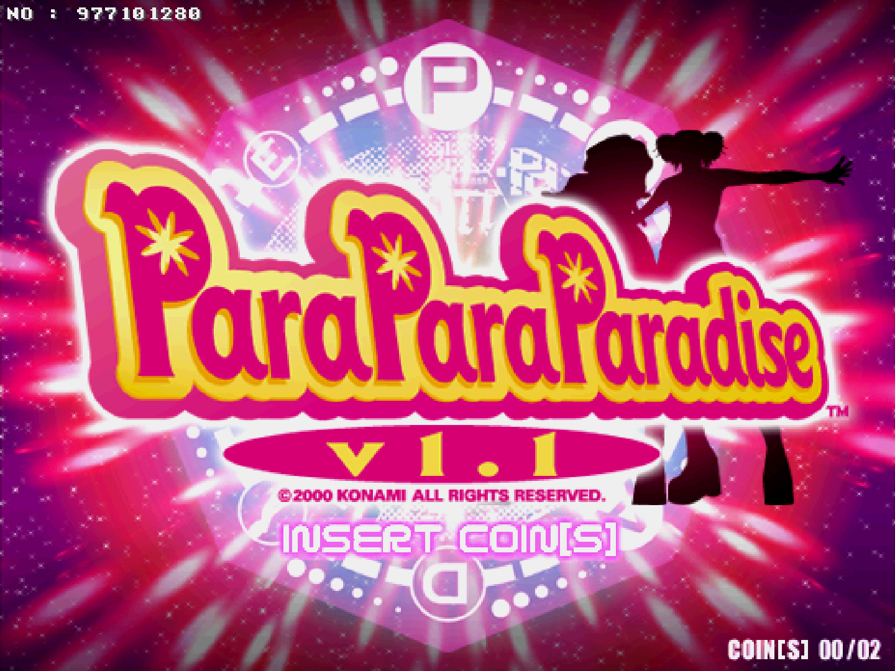
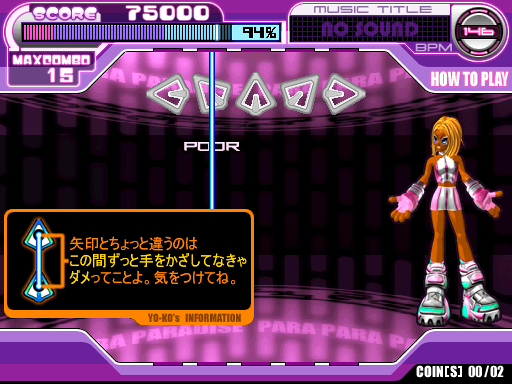

### Pop'n Music 7

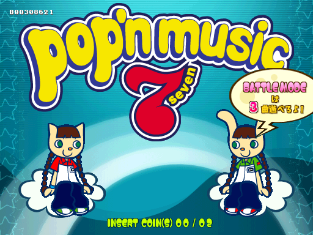
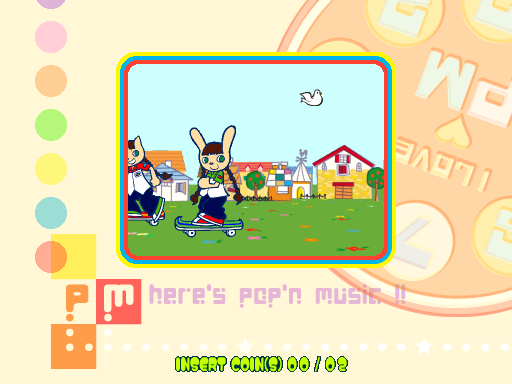
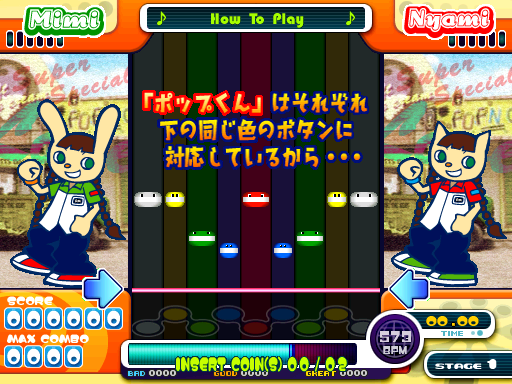
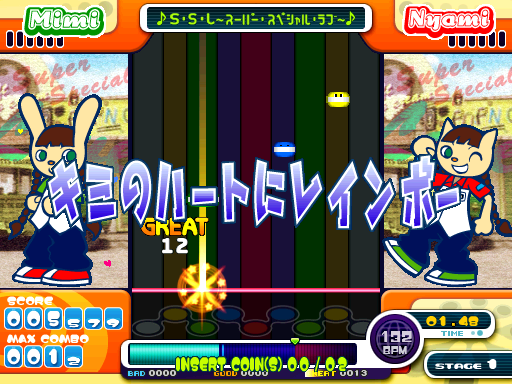

### Keyboardmania

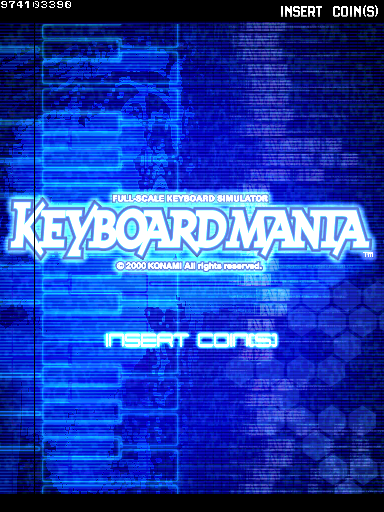
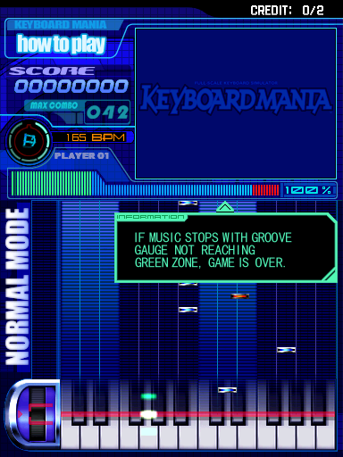

### Development builds

`python scripts/build_staged.py`, then `python scripts/deploy.py` with a `mister.env` (see
`scripts/deploy.py`).

## Status

Known issues:

* **No 15 kHz output** (24 kHz analog only).
* ppd's sensor bars 6-8 are not mapped (used for alternative player orientation for the Korean cabinet only).

`docs/MAME_KLUDGES.md` lists what is taken from MAME as behaviour and what is known not to be
right. `docs/HACKS.md` lists this core's own approximations. `docs/ROADMAP.md` is the plan and its
progress; `docs/LESSONS_LEARNED.md` is what it cost.

### Todo

- [ ] Phase 6 standard features: DIPs, CRT Adjust, flip screen (audio is stereo only, no mix option)
- [ ] Release: Downloader database

### Resource usage

`Firebeat` revision (released as `Firebeat_ppp`) at `4fe2684` (the 20261114 release), fitter seed 10, on the
DE10-nano's Cyclone V 5CSEBA6, speed grade 7, every clock positive (`clk_sys` +0.732 ns, `clk_mem`
+0.503 ns, HDMI +0.198 ns; hold +0.126 ns at worst):

| resource | used | available |
| --- | --- | --- |
| Logic (ALMs) | 33,141 | 41,910 |
| Registers | 35,340 | |
| Block memory bits | 1,187,872 | 5,662,720 |
| RAM blocks | 188 | 553 |
| DSP blocks | 62 | 112 |
| PLLs | 3 | 6 |

79% of ALMs.

`Firebeat_popn` revision at `d230ee8` (the 20261114 release), fitter seed 4, every clock positive
(`clk_sys` +0.550 ns, `clk_mem` +0.850 ns, HDMI +0.100 ns; hold +0.243 ns at worst):

| resource | used | available |
| --- | --- | --- |
| Logic (ALMs) | 36,509 | 41,910 |
| Registers | 36,083 | |
| Block memory bits | 3,174,496 | 5,662,720 |
| RAM blocks | 443 | 553 |
| DSP blocks | 54 | 112 |
| PLLs | 3 | 6 |

87% of ALMs.

`Firebeat_kbm` revision at `3a51f90` (the 20261114 release), fitter seed 12, every clock positive
(`clk_sys` +0.773 ns, `clk_mem` +0.406 ns, HDMI +0.153 ns; hold +0.227 ns at worst):

| resource | used | available |
| --- | --- | --- |
| Logic (ALMs) | 36,634 | 41,910 |
| Registers | 38,186 | |
| Block memory bits | 2,165,142 | 5,662,720 |
| RAM blocks | 322 | 553 |
| DSP blocks | 56 | 112 |
| PLLs | 3 | 6 |

87% of ALMs.

## AI Attestation

This core is being developed with heavy use of a frontier coding assistant.

## Verification

Not PCB-validated. MAME is the accuracy reference, with its own acknowledged uncertainties noted
where they matter.

* CPU and caches: 2,000,000 instructions of ppp11's play loop and 1,777,257 of its loading loop
  equal to MAME's (`sim/cpu_tb`).
* Board bus: 302,908 device accesses in MAME's order (`sim/board_tb`).
* Boot from power-on: 6,000 MAME frames, every ATA data word (7,098,647) equal to MAME's
  (`sim/boot_tb`).
* Flash install: 15,244,959 flash writes in MAME's order, the three chips equal at the end.
* GCU: VRAM 0 pixels differing on the attract and play windows (`sim/gcu_tb`); the shown frame
  equal to MAME's `screen_out` (`sim/disp_tb`).

## Acknowledgements

- **Sorgelig** and the **MiSTer-devel team** for the
  [Template_MiSTer](https://github.com/MiSTer-devel/Template_MiSTer) framework.
- The **MAMEdev team** — Ville Linde and the contributors to `firebeat.cpp`, `k057714.cpp` and the
  device files — for the emulation that is this core's specification.
- The Konami Hornet core's PPC403 (`rtl/cpu/ppc403/PROVENANCE.md`).

## Layout

Standard [Template_MiSTer](https://github.com/MiSTer-devel/Template_MiSTer) structure:

| path | contents |
| - | - |
| `sys` | MiSTer framework, vendored from the template, never edited |
| `rtl` | core source; vendored modules carry a `PROVENANCE.md` |
| `releases` | `.rbf` and `.mra` files; clones in `_alternatives`, work in progress in `_dev` |
| `docs` | roadmap, workflow, release process, kludges, hacks, lessons |
| `sim` | ModelSim and Verilator testbenches |
| `scripts` | build, deploy, capture and verification tooling |
| `debug` | reference captures from MAME used as ground truth (gitignored) |
| `roms` | your own MAME sets (gitignored, never committed) |

## License

GPL-3.0 (see `LICENSE`). Imported components keep their own licences; every modified vendored
file states the change in its header.

Game ROMs contain copyrighted material and are not included. Obtaining them is your
responsibility.
